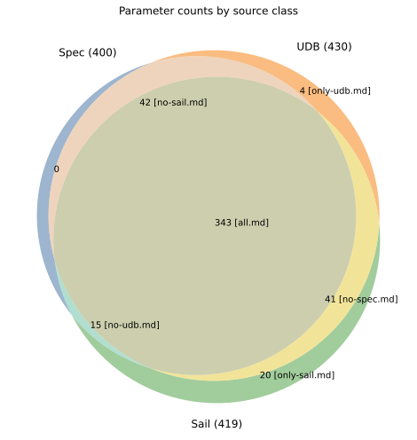

# Unified UDB, Sail, and ISA-manual parameter comparison

This directory compares UDB parameter definitions, the Sail RISC-V model/configuration schema, and the ISA manual. The summary and class reports preserve the evidence and unresolved cases behind each mapping.

The preserved diagram shows intersection-region labels linked to their reports; it was not regenerated in this run, so its counts may be stale. The refreshed [`summary.json`](summary.json) is authoritative for current totals.

## Start here

- [Process summary and source revisions](summary.md)
- [Machine-readable set sizes and class counts](summary.json)
- [Venn diagram SVG](class-venn.svg)
- [Potential UDB development directions](no-udb-clusters.md)
- [Potential Sail development directions](no-sail-clusters.md)

## Class reports

The class bits are ordered `spec` (least significant), `udb`, then `sail`. A set bit means the concept is represented in that source. The six classes contain **465** records: **318** parameter-YAML-backed UDB concepts, **112** UDB extension declarations, and **35** Sail-only concepts.

| Class | Sources represented | Count | Report |
|---|---|---:|---|
| `0b010` | UDB only | 4 | [only-udb.md](only-udb.md) |
| `0b011` | UDB and spec; not Sail | 42 | [no-sail.md](no-sail.md) |
| `0b100` | Sail only; no spec match | 20 | [only-sail.md](only-sail.md) |
| `0b101` | Spec and Sail; no UDB | 15 | [no-udb.md](no-udb.md) |
| `0b110` | UDB and Sail; no spec match | 41 | [no-spec.md](no-spec.md) |
| `0b111` | UDB, spec, and Sail | 343 | [all.md](all.md) |

Source totals are Spec **400**, Sail **419**, and UDB **430**. They overlap and are not additive. Class `0b000` (no source) and `0b001` (spec only) do not occur.

## Potential future directions

The no-udb and no-sail clusters group candidates by architectural concept and likely investigation task. They are evidence-backed prompts for human review, not confirmed defects or implementation commitments.

- [Spec and Sail without UDB: 15 candidates](no-udb-clusters.md)
- [UDB and spec without Sail: 42 candidates](no-sail-clusters.md)

## Reconciliation flow

### 1. UDB-first pass

Each UDB parameter YAML is a starting record. Its `name`, `long_name`, and `description` guide searches across Sail sources/configuration and AsciiDoc specification files. Matches are confirmed against behavior and architectural scope; identifier hits alone are not enough. The current pass covers **318** UDB parameters, with **272** semantic Sail matches and **283** manual concept matches; **261** of the latter have a confidently identified normative anchor.

### 2. Sail-first reverse pass

The rebuilt schema was traversed at configuration-value leaves (**323**). Settings already mapped in the first pass are not duplicated. Remaining leaves are checked against UDB parameter descriptions; the exact shape `extensions.<EXTNAME>.supported` is handled separately by checking for `spec/std/isa/ext/<EXTNAME>.yaml`. That file denotes an extension declaration, not a parameter YAML. This run identified **13** parameter-YAML mappings, **112** extension-declaration mappings, **35** remaining Sail-only entries, and **47** ambiguous or parent-level cases left unresolved.

The schema also exposes `base.reserved_behavior.illegal_privilege`; the manual discusses legal MPP encodings but does not determine Sail's ignore-versus-lowest policy. The reports retain this distinction and its unresolved anchor status.

## How approximate (“fuzzy”) matching works

Matching is semantic and evidence-based, not an edit-distance threshold or an embedding score. Names and descriptions generate candidates; the hierarchy, type, values, source behavior, and relevant specification rule are used to confirm architectural identity. A spec concept mention sets the spec class bit independently of whether a defining normative anchor can be identified.

For example, `MXLEN` maps to Sail `base.xlen` and the machine-mode `misa.MXL` rule ([evidence in all.md](all.md#mxlen)). Conversely, `FORCE_UPGRADE_CBO_INVAL_TO_FLUSH` is not mapped to `base.reserved_behavior.xenvcfg_cbie`: the latter handles reserved CBIE=0b10 writes, not CBIE=0b11 invalidate-versus-flush behavior ([no-sail entry](no-sail.md#force_upgrade_cbo_inval_to_flush)).

When a source only exposes a parent object, when multiple UDB candidates remain plausible, or when behavior differs, the relationship remains unresolved and is reported as such. Clustered absences are candidate gaps only, never proof that a source is deficient.

## Reading the artifacts

- The six class reports provide per-entry UDB, Sail, and spec evidence, including schema pointers, source locations, and unresolved-match notes.
- [summary.md](summary.md) records revisions and aggregate results; [summary.json](summary.json) contains the counts used by the diagram.
- [no-udb clusters](no-udb-clusters.md) and [no-sail clusters](no-sail-clusters.md) are triage views over the corresponding class reports.
